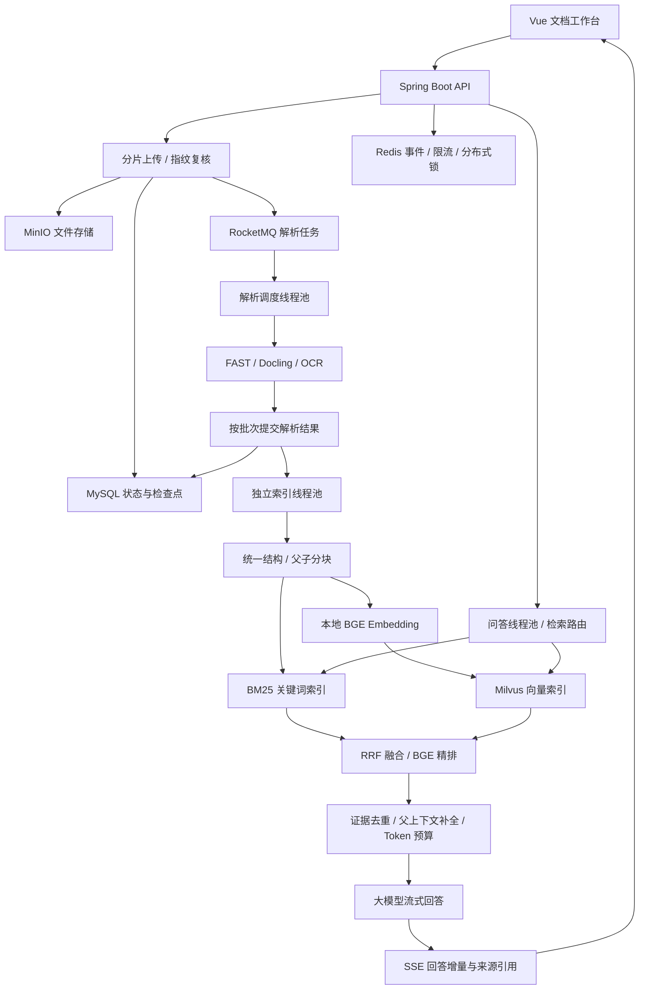

<div align="center">

# DocFlow

### 智能文档解析与知识问答平台

让文档从文件变成可检索、可追溯、可对话的知识。

<p>
  
  
  
  
  
  <a href="./LICENSE"></a>
</p>

[核心能力](#核心能力) · [系统架构](#系统架构) · [核心设计](#核心设计) · [快速开始](#快速开始)

</div>

## 项目介绍

DocFlow 是基于 Spring Boot、Docling 和本地 BGE 模型构建的文档 RAG 平台，提供从 PDF / Word 上传、异步解析、结构化分块、增量索引到流式问答的完整链路。

平台围绕**大文件可靠入库、长任务可恢复、证据精准检索和上下文成本控制**进行设计。用户可在文档聊天与知识库工作台中管理文件、查看解析内容、选择检索范围，并在回答中追溯原文来源。

## 核心能力

- **可靠上传**：分片传输、暂停恢复、断点续传；分片 SHA-256 校验与服务端完整文件指纹复核，支持内容去重。
- **异步入库**：RocketMQ 解耦上传与解析，批次结果持久化后驱动增量索引，让解析与向量化形成流水线。
- **结构化解析**：结合原生 PDF 文本提取、Docling 与中英文 OCR，保留段落、章节、表格和来源信息。
- **层级分块**：统一文档结构表示，结合结构感知与 Parent-Child 分块，实现小块检索、按需补全父上下文。
- **混合检索**：BM25 与 BGE 向量双路召回，通过 RRF 融合、BGE Reranker 精排及章节匹配定位相关证据。
- **自适应问答**：根据文档规模、索引状态和查询范围选择处理策略，动态分配原文、历史与输出预算。
- **流式交互**：SSE 实时推送回答与处理阶段，支持事件回放、断线续收和请求幂等。
- **知识库管理**：按知识库、文档与版本组织内容，结合身份适配与权限校验控制检索范围。

## 技术栈

| 层次 | 技术 | 主要职责 |
| --- | --- | --- |
| 前端 | Vue 3、Vite、SSE | 文档上传、知识库管理、聊天与来源展示 |
| 后端 | Java 21、Spring Boot、MyBatis-Plus、LangChain4j | 鉴权、上传、任务编排与问答服务 |
| 数据与存储 | MySQL、Redis、MinIO | 业务状态、上传回执、检查点、事件与文件存储 |
| 异步与并发 | RocketMQ、Redisson、有界线程池 | 任务解耦、削峰、并发互斥与资源隔离 |
| 文档解析 | Python、FastAPI、Docling、PDFium、Tesseract | PDF / DOCX 解析、结构提取与中英文 OCR |
| 检索与精排 | BM25、Milvus、BGE Embedding、BGE Reranker、RRF | 词法召回、向量召回、融合与相关性排序 |
| 模型接入 | DeepSeek、OpenAI 兼容接口 | 流式生成与可选查询改写 |
| 部署 | Docker Compose、Maven、GitHub Actions | 服务编排、构建与持续集成 |

本地检索服务默认使用 `BAAI/bge-small-zh-v1.5` 生成向量，使用 `BAAI/bge-reranker-base` 执行精排。检索模型与聊天模型独立部署，常规文档入库通过解析、分块和向量化完成。

## 系统架构



## 核心设计

### 1. 大文件可靠上传与内容去重

前端在 Web Worker 中计算文件指纹，按分片提交文件并支持暂停。后端校验每个分片的 SHA-256，将分片写入 MinIO 后持久化上传回执，再向前端确认；恢复上传时，根据已确认的分片记录补传缺失部分。

全部分片就绪后，由服务端合并并复算完整文件指纹，在所属用户与知识库等业务范围内匹配已有内容，复用可用文件记录，减少重复传输、存储与后续处理。

### 2. 异步流水线与故障恢复

上传完成后提交解析任务，耗时处理由 RocketMQ 消费端承接。解析、索引和聊天使用独立有界线程池，隔离资源竞争。

每批解析结果与进度检查点持久化后，索引任务读取新增批次执行分块、向量化和索引写入，实现阶段间流水线并行。结合 Redisson 分布式锁、WatchDog 续期、持久化检查点及幂等写入控制重复处理，失败重试从已提交的批次继续推进。

### 3. 结构感知分块与来源追溯

将解析器输出转换为统一文档结构，保留章节路径、段落类型、表格与来源关联。正文与引用元数据通过 Block ID 连接，使检索上下文聚焦内容，引用展示按需读取页码与来源信息。

检索索引以子块为主要单元；需要上下文时，根据父子关系补全相关段落群，兼顾匹配粒度与阅读完整性。针对跨页段落、列表与续表执行边界连续性处理，并保留原始来源关联。

### 4. 混合检索与低置信度回退

规则路由器根据查询意图、词项与文档状态选择 BM25、Dense 或 Hybrid 路径。单路检索结合正文词项覆盖、明确约束匹配或向量相似度判断结果质量，低置信度时补充另一召回通道；Hybrid 作为综合召回路径。

双路候选通过 RRF 融合，再由 BGE Reranker 排序。对长候选按问题词项定位相关片段，在 256 Token 精排输入预算内保留关键信息，控制推理计算量。精排使用的片段与最终阅读的原文分别组织，回答上下文仍按证据来源获取。

支持可选的模型查询改写：保留原始问题一路，将受约束的改写查询用于补充召回，合并候选后统一精排。

### 5. 按需上下文与流式问答

根据文档规模、索引进度和问题范围，组织直接上下文、局部 RAG、全文分析、多文档对比及增量可用五类处理策略。

上下文构建时执行证据去重、父上下文补全，并为原文、对话历史、模型输出和安全余量分配预算。SSE 推送检索、生成、引用校验阶段与回答增量；客户端携带事件位置续收消息，同一请求 ID 复用已有任务，避免重复提交触发额外调用。

### 6. 权限边界与调用保护

以“知识库 → 文档 → 版本”组织数据，检索与父上下文读取沿用所属用户、知识库、文档版本等范围约束。通过 `PermissionChecker` 与身份适配接口对接业务权限规则。

利用 Redis / Redisson 实施用户级与全局限流，对可重试的模型调用故障采用有上限的指数退避，配合任务状态与阶段事件提升运行可观测性。

## 快速开始

### 环境准备

- JDK 21+、Maven 或项目自带 Maven Wrapper。
- Node.js 22+。
- Docker Engine / Docker Desktop 与 Compose v2。

### 1. 获取代码并准备配置

```bash
git clone https://github.com/Fiee-oxy/DocFlow.git
cd DocFlow
cp .env.example .env
```

Windows PowerShell 可使用 `Copy-Item .env.example .env`。

在 `.env` 中设置数据库、Redis、MinIO 等服务密码，并配置聊天模型。接入 DeepSeek 官方接口时：

```dotenv
SILICONFLOW_API_KEY=<你的 DeepSeek API Key>
SILICONFLOW_BASE_URL=https://api.deepseek.com
LLM_MODEL=<账户可用的模型 ID>
```

上述环境变量名称兼容项目现有模型配置，密钥、接口地址与模型 ID 应使用同一服务平台提供的配置。

### 2. 启动基础服务与解析服务

```bash
# 准备本地检索镜像依赖的解析运行环境
docker build -t dovideo-docling:local ./services/docling

# 初始化 RocketMQ 数据卷权限
docker compose --env-file .env run --rm --no-deps --user root --entrypoint sh rmqbroker -c "mkdir -p /home/rocketmq/store /home/rocketmq/logs && chown -R 3000:3000 /home/rocketmq/store /home/rocketmq/logs"

# 启动 MySQL、Redis、MinIO、RocketMQ 与文档解析服务
docker compose --env-file .env --profile documents up -d --build

# 启动本地 BGE 检索服务与 Milvus
docker compose --env-file .env -f services/retrieval/compose.yml up -d --build
```

等待 RocketMQ Broker 就绪后创建文档任务主题：

```bash
docker compose --env-file .env exec rmqbroker sh -c '$ROCKETMQ_HOME/bin/mqadmin updateTopic -n rmqnamesrv:9876 -c DefaultCluster -t document-analysis-topic'
```

模型下载后保存在 Docker 命名卷中，后续启动复用本地模型文件。

### 3. 启动后端

Windows PowerShell：

```powershell
powershell -ExecutionPolicy Bypass -File .\scripts\start-local-backend.ps1
```

Linux / macOS：

```bash
set -a
source .env
set +a
cd server
./mvnw spring-boot:run
```

后端启动时自动执行数据库迁移，默认访问地址为 `http://localhost:9090`。

### 4. 启动前端

另开终端：

```bash
cd client
npm ci
npm run dev
```

访问 **http://localhost:5173**，注册并登录后创建或选择知识库，上传 PDF / DOCX，即可查看解析内容并发起问答。

### 常用地址

| 服务 | 地址 |
| --- | --- |
| Web 工作台 | http://localhost:5173 |
| 后端健康检查 | http://localhost:9090/health |
| MinIO 控制台 | http://localhost:9001 |
| 文档解析服务 | http://localhost:5001/docs |
| 本地检索服务 | http://localhost:5002/docs |

## 关键配置

| 配置项 | 用途 |
| --- | --- |
| `DOCUMENT_PDF_PARSER` | PDF 解析路径，支持 FAST / DOCLING 等模式 |
| `DOCUMENT_OCR_ENABLED` | 扫描页 OCR 开关 |
| `DOCUMENT_PARSE_BATCH_PAGES` / `DOCUMENT_FAST_BATCH_PAGES` | 解析批次大小 |
| `DOCUMENT_PARSER_WORKERS` / `DOCUMENT_CHAT_WORKERS` | 解析与聊天并发配置 |
| `DOCUMENT_DENSE_TOP_K` / `DOCUMENT_SPARSE_TOP_K` | 两路召回候选数量 |
| `DOCUMENT_FUSION_TOP_K` / `DOCUMENT_FINAL_TOP_K` | 融合池与最终精排数量 |
| `RERANK_MAX_TOKENS` | 精排输入预算，默认 256 Token |
| `DOCUMENT_RETRIEVAL_FALLBACK_ON_LOW_CONFIDENCE` | 低置信度补充召回 |
| `DOCUMENT_QUERY_REWRITE_ENABLED` | 模型查询改写开关 |
| `DOCUMENT_CONTEXT_TOKENS` / `DOCUMENT_OUTPUT_TOKENS` | 上下文与输出预算 |

## 目录结构

```text
DocFlow/
├── client/                  # Vue 文档工作台
├── server/                  # Spring Boot API、异步入库与问答
│   └── src/main/resources/db/migration/  # 数据库迁移
├── services/
│   ├── docling/             # 解析、OCR 与结构处理
│   └── retrieval/           # BGE、BM25、Milvus 与精排
├── config/                  # 检索路由规则
├── rocketmq/                # Broker 配置
├── extension/               # 浏览器视频工作台扩展
├── scripts/                 # 启动、诊断与自动化工具源码
├── .github/workflows/       # 持续集成
├── docker-compose.yml       # 基础服务编排
└── .env.example             # 环境变量模板
```

## 致谢与许可证

项目在 [DOVideo-AI](https://github.com/Xiaoc7r/DOVideo-AI) 的工程基础上，围绕文档解析、知识入库与 RAG 问答持续演进，并保留视频工作台与浏览器扩展能力。

感谢 Docling、BGE、Milvus、Apache RocketMQ 等开源项目。

本项目遵循 [MIT License](./LICENSE)。

